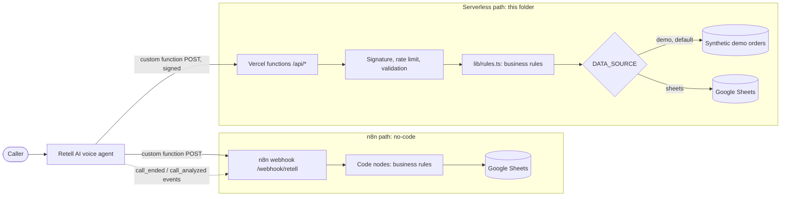
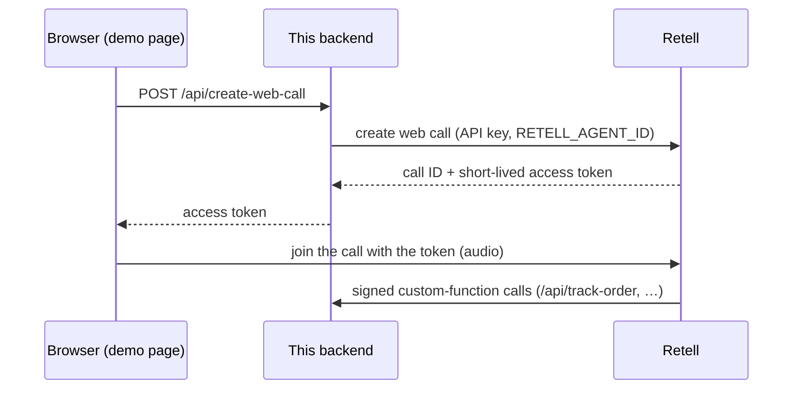

# Lumina serverless backend

A Vercel serverless backend that Retell's custom functions can call instead of the n8n webhook. It applies the same business rules as the n8n workflow and returns the same response fields, so the Retell agent prompts stay as they are. The n8n workflow is untouched and remains the no-code option.

It also serves a demo page with a "Start call" button, so anyone with the link can talk to the agent from their browser.

By default it serves synthetic demo orders, so a public deployment never reads or changes real data.

## Architecture



Each Retell custom function has its own URL, so you choose the backend per function by changing that URL. Post-call events (`call_ended`, `call_analyzed`) are not handled here; leave the agent-level webhook URL pointing at n8n if you use that logging.

|                        | n8n                            | Serverless                                              |
| ---------------------- | ------------------------------ | ------------------------------------------------------- |
| Hosting                | n8n Cloud or self-hosted       | Vercel (free tier is enough for a demo)                 |
| Editing rules          | Visual, in Code nodes          | TypeScript in `lib/rules.ts`, covered by tests          |
| Request authentication | None in the reference workflow | Retell signature verified on every request              |
| Customer verification  | Order ID is enough             | Email or phone must match for cancel, return and refund |
| Data                   | Three Google Sheets            | Synthetic demo orders, or one Google Sheet              |
| Post-call logging      | Yes                            | No                                                      |

## Layout

```
api/       One file per route (thin: they only pick the route)
lib/
  rules.ts       Business rules. Pure functions, no I/O. Used by every route.
  service.ts     Loads the order, verifies the caller, applies the rule, saves.
  http.ts        Request pipeline: method, CORS, rate limit, size, signature, validation, errors.
  schema.ts      zod schemas for what Retell sends.
  config.ts      Environment variables and the fail-fast check.
  data/          OrderRepository interface, demo adapter, Google Sheets adapter.
web/       The Talk to Lumina page (Vite + TypeScript). Built into public/, served at /.
tests/     Unit, contract, security and integration tests (vitest).
scripts/   smoke.ts (checks a live deployment), dev-server.ts (local server).
```

## Endpoints

| Method | Path | What |
| -------- | -------------------------------------------------------------------------------------- |
| `/` | The "Talk to Lumina" page (`web/`): e-commerce order help by voice, with a live transcript under the mic |
| `/kit/` | The kit page from [`../landing-page`](../landing-page), built by `scripts/build-landing.ts` |
| `/api/*` | The serverless functions |

Old `/demo/` links redirect to `/`. The kit page links back to `/` with a **Talk to Lumina** button only in this combined build; its GitHub Pages build is unchanged.

How a call starts:



The Retell API key never reaches the browser. The page uses Retell's `retell-client-js-sdk` with its one request rerouted to `/api/create-web-call`. That endpoint:

- uses the agent in `RETELL_AGENT_ID` and ignores everything in the request body, so a visitor cannot pick another agent or override its settings;
- only answers pages served from this deployment, or origins in `ALLOWED_ORIGINS`;
- is rate limited per visitor and overall (`WEB_CALL_*`), because every call uses Retell minutes;
- returns 503 until `RETELL_AGENT_ID` is set, and the page then shows the demo as offline.

The page shows the call state, a timer, mute and end buttons, and a sound-level indicator. It does not show a live transcript: Retell's client only streams the transcript when the browser holds a Retell key, which this setup avoids on purpose.

To put the button on another site (the landing page, for example), add that site's origin to `ALLOWED_ORIGINS`.

## Business rules

Ported from the n8n Code nodes. Tests in `tests/rules.test.ts`.

| Rule                | n8n node                           | Behaviour                                                                                                       |
| ------------------- | ---------------------------------- | --------------------------------------------------------------------------------------------------------------- |
| Cancellation window | Check Cancellation Eligibility     | Allowed on or before the delivery date. Missing or unreadable date: not allowed.                                |
| Return window       | Evaluate Return Eligibility Policy | Allowed up to 14 days after delivery.                                                                           |
| Refund eligibility  | Evaluate Refund Eligibility Policy | Checked in order: delivery date present, not already refunded, item unopened, return initiated, within 14 days. |
| Intent routing      | Route by User Intent               | Substring match on the intent text.                                                                             |

Where this backend is stricter than n8n:

- Cancel, return and refund need an email or phone number that matches the order. n8n accepts the order ID alone.
- A confirmed action (`*_initiated: "yes"`) re-checks eligibility before writing. n8n writes without checking.
- The refund amount is the order's price. n8n writes the amount the caller supplied.
- An already cancelled or delivered order cannot be cancelled; an undelivered or cancelled order cannot be returned. n8n compares dates only.
- Tracking without an email or phone returns status, carrier and date, but not the customer's name or address.
- Messages contain no order IDs, emoji or markdown, because they are spoken.

Delivery dates are read as `DD-MM-YY` (the n8n sheet format) or `YYYY-MM-DD`.

## Environment variables

| Variable                        | Required          | Default  | Purpose                                                                                  |
| ------------------------------- | ----------------- | -------- | ---------------------------------------------------------------------------------------- |
| `RETELL_API_KEY`                | Yes               |          | Verifies the `X-Retell-Signature` header. Use the Retell API key with the webhook badge. |
| `RETELL_AGENT_ID`               | For the demo page |          | The agent the page's "Start call" button rings. Empty switches browser calls off.        |
| `WEB_CALL_MAX_PER_IP`           | No                | `5`      | Browser calls one visitor may start per window.                                          |
| `WEB_CALL_MAX_GLOBAL`           | No                | `40`     | Browser calls all visitors together may start per window.                                |
| `WEB_CALL_RATE_LIMIT_WINDOW_MS` | No                | `600000` | Window for the two limits above (10 minutes).                                            |
| `DATA_SOURCE`                   | No                | `demo`   | `demo`, `sheets` or `supabase`.                                                          |
| `SUPABASE_URL`                  | If `supabase`     |          | Project URL, e.g. `https://abcd1234.supabase.co`.                                        |
| `SUPABASE_SERVICE_ROLE_KEY`     | If `supabase`     |          | Server-only `service_role` or `sb_secret_...` key. Never the anon/publishable key.       |
| `SUPABASE_TABLE`                | No                | `orders` | Table created by `supabase/schema.sql`.                                                  |
| `SUPABASE_TIMEOUT_MS`           | No                | `2000`   | Timeout per Supabase attempt.                                                            |
| `SUPABASE_MAX_RETRIES`          | No                | `1`      | Retries after the first attempt, with exponential backoff.                               |
| `GOOGLE_SERVICE_ACCOUNT_JSON`   | If `sheets`       |          | Service-account key file as one line of JSON, or base64.                                 |
| `GOOGLE_SHEET_ID`               | If `sheets`       |          | Spreadsheet ID from the sheet URL.                                                       |
| `GOOGLE_SHEET_TAB`              | No                | `Orders` | Tab holding the orders.                                                                  |
| `ALLOWED_ORIGINS`               | No                | empty    | Exact browser origins allowed by CORS, comma-separated. Empty means none.                |
| `RATE_LIMIT_WINDOW_MS`          | No                | `60000`  | Rate-limit window.                                                                       |
| `RATE_LIMIT_MAX_PER_IP`         | No                | `120`    | Requests per window per IP.                                                              |
| `RATE_LIMIT_MAX_PER_CALL`       | No                | `20`     | Requests per window per Retell `call_id` (full payload only).                            |
| `MAX_BODY_BYTES`                | No                | `102400` | Largest accepted body.                                                                   |
| `SHEETS_TIMEOUT_MS`             | No                | `1500`   | Timeout per Google Sheets attempt.                                                       |
| `SHEETS_MAX_RETRIES`            | No                | `1`      | Retries after the first attempt, with exponential backoff.                               |
| `SHEETS_BACKOFF_MS`             | No                | `100`    | First backoff delay.                                                                     |
| `SHEETS_CACHE_TTL_MS`           | No                | `15000`  | How long one read of the sheet is reused. `0` disables.                                  |
| `BUSINESS_TIMEZONE`             | No                | `UTC`    | Decides what "today" is, for example `Asia/Karachi`.                                     |
| `CURRENCY_LABEL`                | No                | `PKR`    | Spoken after refund amounts.                                                             |

### Using Supabase as the database

1. Create a project at supabase.com.
2. Open **SQL Editor → New query**, paste [`supabase/schema.sql`](supabase/schema.sql) and run it. It creates the `orders` table, turns on Row Level Security with no policies (so the public key can read nothing), and adds eight synthetic test orders.
3. In **Project Settings → API**, copy the **Project URL** and the **service_role** (or **secret**) key.
4. Set `DATA_SOURCE=supabase`, `SUPABASE_URL` and `SUPABASE_SERVICE_ROLE_KEY` in Vercel, then redeploy.
5. Check: `/api/health` reports `data_source: "supabase"`, and asking the agent about `ORD-TEST-001` finds the order.

Order IDs are matched on letters and digits only (the generated `order_key` column), so speech-to-text variations still find the order. Load your real orders into the same table and delete the `ORD-TEST-*` rows when you go live.

If a required variable is missing or invalid, every request gets a generic 500, `/api/health` returns 503, and the log names the variable (never its value). In production a placeholder-looking `RETELL_API_KEY` is rejected too.

## Run locally

```bash
cd serverless
```

```bash
npm install
```

```bash
printf 'RETELL_API_KEY=any-long-local-string\n' > .env
```

With the Vercel CLI (needs a Vercel login):

```bash
npm run dev
```

Without it, build the pages once (landing page and demo page; needs internet for the landing page's pnpm install) and use the bundled Node server on port 3000:

```bash
npm run build
```

```bash
npm run dev:local
```

Open http://localhost:3000 for the Talk to Lumina page and http://localhost:3000/kit/ for the kit page. To make its call button work locally, put a real `RETELL_API_KEY` and `RETELL_AGENT_ID` in `.env`. While editing the page, `npm run dev:web` serves it with live reload on port 5173 and forwards `/api` to port 3000.

Then, in another terminal, send signed sample requests:

```bash
npm run smoke -- http://localhost:3000
```

Checks:

```bash
npm run lint
```

```bash
npm run typecheck
```

```bash
npm test
```

## Deploy

First time only, link the folder to a Vercel project and add the key:

```bash
npx vercel link
```

```bash
npx vercel env add RETELL_API_KEY production
```

```bash
npx vercel env add RETELL_AGENT_ID production
```

Then deploy with one command:

```bash
npm run deploy
```

`npm run deploy` runs from the repository root, because the build also needs `landing-page/`.

If you import the repository in the Vercel dashboard instead (recommended), set **Root Directory** to `serverless`, leave **Framework Preset** on **Other**, and keep **Include files outside the root directory in the Build Step** switched on (the default), so the build can reach `landing-page/`.

Verify the deployment (reads `RETELL_API_KEY` from the environment or `.env`):

```bash
npm run smoke -- https://YOUR-PROJECT.vercel.app
```

Add `--mutate` to also cancel a demo order twice and confirm the second call changes nothing.

Use the production URL in Retell. Vercel preview URLs are behind Vercel's login by default, so Retell cannot reach them.

## Point Retell at this backend

In each custom function in the Retell dashboard, replace the n8n URL:

| Retell function          | Endpoint                                                 |
| ------------------------ | -------------------------------------------------------- |
| `check_order`            | `https://YOUR-PROJECT.vercel.app/api/track-order`        |
| `cancel_order_status`    | `https://YOUR-PROJECT.vercel.app/api/cancel-order`       |
| `cancel_order_initiated` | `https://YOUR-PROJECT.vercel.app/api/cancel-order`       |
| `return_order_status`    | `https://YOUR-PROJECT.vercel.app/api/return-item`        |
| `return_order_initiated` | `https://YOUR-PROJECT.vercel.app/api/return-item`        |
| `refund_order_status`    | `https://YOUR-PROJECT.vercel.app/api/refund-eligibility` |
| `refund_order_initiated` | `https://YOUR-PROJECT.vercel.app/api/refund-eligibility` |

Or paste `https://YOUR-PROJECT.vercel.app/api/order` into all seven, which mirrors the single n8n webhook.

Keep method `POST` and "Payload: args only" as exported. Two things to check in Retell:

1. **`return_order_initiated` has no `email` or `phone_no` parameter** in the exported agent. Add both (type string), otherwise the return cannot be verified and the agent will be asked for contact details. The prompts do not need to change.
2. The function timeout is 120000 ms in the export. This backend answers in milliseconds on demo data; lowering the timeout to about 5000 ms makes a failure audible sooner.

To switch a function back to n8n, paste the n8n URL back.

## Using Google Sheets

Set `DATA_SOURCE=sheets` and the two Google variables, and share the sheet with the service account as an editor (viewer is enough if you only use the check functions).

The adapter reads one tab with one row per order. Columns are matched by header name, ignoring case, spaces and punctuation, so the order does not matter. The n8n workflow spreads these across three spreadsheets; here they live in one tab.

| Column                                                                                                 | Needed for            |
| ------------------------------------------------------------------------------------------------------ | --------------------- |
| `OrderID`                                                                                              | Everything (required) |
| `Email`, `PhoneNo`                                                                                     | Customer verification |
| `CustomerName`, `Status`, `Carrier`, `TrackingNumber`, `Delivery`, `DeliveryLocation`, `TrackingSteps` | Tracking              |
| `Status`, `Delivery`, `CancelDate`, `Reason`                                                           | Cancellation          |
| `Item`, `ItemCondition`, `ReturnStatus`, `ReturnReason`, `ReturnInitiate`                              | Returns               |
| `Price`, `RefundStatus`, `RefundAmount`, `RefundDate`                                                  | Refunds               |

`Delivery` may be `DD-MM-YY` or `YYYY-MM-DD`. `TrackingSteps` are separated by semicolons. An action fails safely (HTTP 503, nothing written) if a column it must write to is missing.

## Demo orders

All synthetic. Orders 001 to 003 are the ones in `demo/orders.json`; the others have delivery dates relative to today so they stay demoable.

| Order          | Email               | Phone       | State                                | Try                                         |
| -------------- | ------------------- | ----------- | ------------------------------------ | ------------------------------------------- |
| `ORD-TEST-001` | alex@example.test   | +1-555-0101 | Shipped, due 31 Dec 2026             | Track                                       |
| `ORD-TEST-002` | sam@example.test    | +1-555-0102 | Processing, no delivery date         | Track; cancel is refused (no delivery date) |
| `ORD-TEST-003` | taylor@example.test | +1-555-0103 | Delivered 20 Aug 2026                | Return is refused (window passed)           |
| `ORD-TEST-004` | jordan@example.test | +1-555-0104 | Processing, due in 5 days            | Cancel                                      |
| `ORD-TEST-005` | casey@example.test  | +1-555-0105 | Delivered 3 days ago, unopened       | Return, then refund                         |
| `ORD-TEST-006` | riley@example.test  | +1-555-0106 | Delivered 5 days ago, return started | Refund                                      |
| `ORD-TEST-007` | morgan@example.test | +1-555-0107 | Delivered 30 days ago                | Refund is refused (window passed)           |
| `ORD-TEST-008` | avery@example.test  | +1-555-0108 | Delivered 4 days ago, opened         | Refund is refused (opened)                  |

Demo changes (a cancellation, for example) are kept in memory only. They disappear when Vercel recycles the instance, and two instances may briefly disagree. That is intended for a public demo; use `DATA_SOURCE=sheets` for state that lasts.

## Security

See [`../SECURITY.md`](../SECURITY.md) for the threat model and protections. Run the security tests with:

```bash
npm run test:security
```
